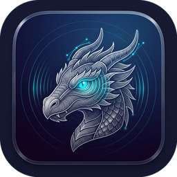

<p align="center">
  
</p>

<h1 align="center">VectorCraft: Sense Edition</h1>

<p align="center">
  <b>The Predictive, Smart & Intuitive Vector Suite.</b><br>
  <i>A pure Rust vector illustration environment designed around spatial intuition, live previewing, and zero-latency human flow.</i>
</p>

<p align="center">
  
  
  
  
  
</p>

<p align="center">
  <a href="#the-manifesto">The Manifesto</a> •
  <a href="#the-8-pillars-of-sense-edition">Core Features</a> •
  <a href="#comparison-matrix">Vs. Legacy Monopolies</a> •
  <a href="#community-roadmap">Community & Roadmap</a> •
  <a href="#getting-started">Installation</a> •
  <a href="#build-from-source">Build from Source</a>
</p>

---

## 💥 The Manifesto: Vector Illustration Was Abandoned in 1987

For nearly four decades, the vector illustration industry has been held hostage by a \$60/month monopoly. The core paradigm hasn't changed since the 1990s:

* **Blind Boolean Guesses:** You click *Minus Front*, pray you chose the right shape order, hit `Ctrl+Z`, swap layers, try *Exclude*, hit `Ctrl+Z` again.
* **The Infamous 1-Pixel Seam:** You snap two shapes edge-to-edge. The renderer misses by a sub-pixel fraction, leaving an ugly white anti-aliasing hairline seam right down the middle of your art.
* **Modal Dialog Purgatory:** Want to offset a path or transform? An unresizable dialog blocks your screen. You type numbers blindly, check/uncheck the "Preview" box, and can't pan or zoom while the dialog is open.
* **Buried Property Hunting:** You spend more time squinting at tiny property panels in the far corners of your monitor than looking at your canvas.
* **Lag on \$3,000 Hardware:** M-series Macs and RTX workstations drop frames on 10,000 vector nodes while background DRM daemons burn CPU.

**VectorCraft: Sense Edition** is the community-driven antidote. We believe your software should **anticipate what you are about to do** and show you the outcome before you commit.

---

## ⚡ The 8 Pillars of Sense Edition

### 1. 🔮 Predictive Pathfinder (Zero-Click Booleans)
Hover over *Unite*, *Minus Front*, *Intersect*, or *Exclude* in the Pathfinder palette — the canvas instantly calculates and renders the live boolean topology in real-time. Move the cursor away, and your original curves restore seamlessly. One click commits. No more trial-and-error undo loops.

### 2. 🧲 Smart Magnetic Physics (Sub-Pixel Precision)
Solves the chronic 1px misalignment problem once and for all. Geometric corners, anchor points, tangents, and guide intersections possess true magnetic physical pull. Snapping is tactile, exact, and mathematically eliminates edge-to-edge anti-aliasing rendering seams.

### 3. 📏 Direct On-Canvas Spatial HUD (Scroll-Wheel Driven)
When creating or resizing geometry (circles, rectangles, polygons), a high-contrast, semi-transparent 48px HUD badge floats right beside the object displaying live dimensions (`Ø 50.00 pt`, `120 × 80 pt`). 
* Hover directly over the numbers and spin your **mouse wheel or two-finger touchpad** to dynamically scale the geometry in real-time.
* Zero travel to side panels. Your eyes never leave your drawing.

### 4. 🔍 Proximity Fish-Eye Toolbar
Fitts's Law done right. As your cursor approaches tool icons or docking panels, the interactive targets smoothly expand (up to 1.35× magnification) with smooth mathematical falloff. Hitting buttons is effortless, while the canvas remains spacious and unobscured.

### 5. 🪟 Predictive Peek Docking
Floating inspector palettes shouldn't cover your artwork. In Sense Edition, docked panels gracefully collapse into slim icons when you are working on the canvas, and expand smoothly into full view the moment your cursor travels toward them.

### 6. 📐 Macromedia FreeHand Hairlines
Bringing back the beloved gold standard of vector drafting: true, resolution-independent **Hairlines**. A constant-width 0.25 pt / 1 px hairline that never explodes in thickness when zooming in, essential for precision CAD-like drafting, architectural sketches, and laser-cutting blueprints.

### 7. 🧹 Zero-Artifact Topology Engine
Boolean operations and stroke expansion in traditional tools dump hundreds of collinear, duplicate, and phantom anchor points onto straight segments. Sense Edition’s geometry engine cleans and simplifies path topology automatically without altering your intended curve bezier profiles.

### 8. 🦀 Pure Rust High-Throughput Core
Written from scratch in clean-room Rust. No Electron bloat, no garbage collection stutters, no background daemons, zero panics. Asynchronous saving ensures the UI never hitches or freezes on multi-megabyte illustrations.

---

## 🥊 Comparison Matrix

| Capability | Adobe Illustrator | Inkscape | Figma | **VectorCraft: Sense Edition** |
|:---|:---:|:---:|:---:|:---:|
| **Pathfinder Booleans** | Blind Click → Undo Loop | Menu Dropdown | Mask/Flatten | **Live Real-time Hover Preview** |
| **Object Dimensions** | Buried Panel Input | Top Toolbar | Right Sidebar | **On-Canvas 48px HUD + Scroll Wheel** |
| **Corner & Guide Snap** | 1px drift / white seams | Rigid snap bar | Basic bounding box | **Magnetic Physics (0-drift)** |
| **Hairline Drafting** | ❌ Abandoned | ❌ No true hairline | ❌ None | **✅ True Scale-Invariant Hairline** |
| **Toolbar Ergonomics** | Tiny static 16px icons | Cluttered lists | Minimalist | **Proximity Fish-Eye Magnification** |
| **Inspector Panels** | Static modal clutter | Heavy docks | Fixed sidebars | **Predictive Peek on Hover** |
| **License & Pricing** | \$30–60 / month forever | GPL v3 | Freemium Cloud | **100% Free & Open Source (MIT/Apache)** |
| **Telemetry & Cloud** | Mandatory background DRM | None | Closed Cloud | **Zero Telemetry, 100% Offline Local** |
| **Engine Architecture** | 38-year-old C++ monolith | C++ / GTK / Python | WebGL / WASM | **Pure Rust, 120 FPS Native GPU** |

---

## 🤝 Community & Roadmap: Build the Future of Vector UX

**VectorCraft: Sense Edition** is an independent community initiative dedicated to building the most intuitive, predictive vector tool on earth. 

We are actively recruiting:
* **Vector Illustrators & Type Designers:** Stress-test our workflows, break our snapping, and tell us where current software still frustrates you.
* **Rust Graphics Engineers:** Help optimize our bezier rasterization, geometry boolean solvers, and spatial acceleration trees.
* **UX Researchers:** Help design new predictive interactions:
  - *Direct on-canvas Offset Path drag handles* (no modal dialogs).
  - *Smart Repeat Arrays* (Alt-drag ghost previews showing exact spacing).
  - *Global Color Physics* (live palette propagation without nested Recolor Artwork labyrinths).

💬 **Get Involved:**
* Open an **RFC Discussion** for new predictive interaction paradigms.
* Report friction and edge cases in **GitHub Issues**.
* Submit PRs — clean-room, tested, zero-panic Rust.

---

## 📦 Getting Started

### Windows
* **MSI Installer:** Download `vectorcraft-sense-windows-x64.msi` from Releases (per-machine or per-user setup with Start Menu & desktop integration).
* **Portable ZIP:** Extract and run `vectorcraft.exe` anywhere (settings stored locally next to binary).

### macOS
* Native universal binary for Apple Silicon (`aarch64`) and Intel (`x86_64`).
* Full support for macOS native menus, Metal GPU rendering, and Retina displays.

### Linux & FreeBSD
* Native Wayland & X11 builds with full stylus pressure, tilt, and barrel button support.

---

## 🛠️ Build from Source

Requirements: Modern Rust toolchain (`rustc >= 1.85`).

```bash
# Clone the repository
git clone https://github.com/assantaldybai/vectorcraft.git
cd vectorcraft

# Run native release build
cargo run --release -p vectorcraft

# Run the test suite (zero warnings, clean-room verified)
cargo xtask ci
```

---

## 📄 License & Clean-Room Guarantee

* Code is distributed under **MIT OR Apache-2.0**.
* **Clean-room developed:** Built entirely from public specifications and human motor ergonomics. Zero proprietary assets, zero reverse engineering, zero telemetry.
* You own your software, your tools, and your art forever.
